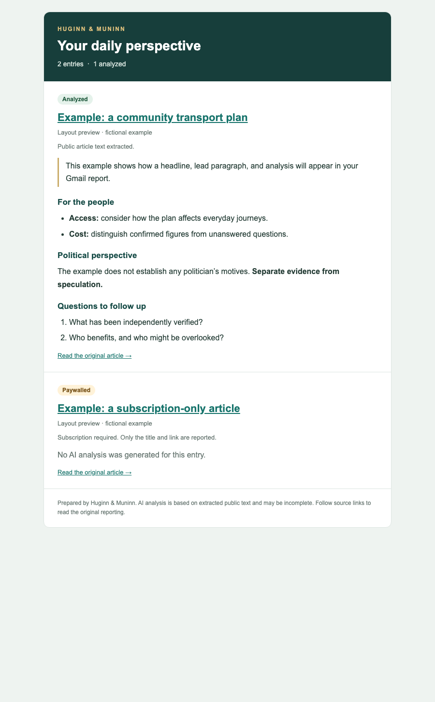

# sct-huginnmuninn  
**Social Climate Tech – SocialLab AI News Summarizer**

---

## Who Are Huginn & Muninn?  
In Norse mythology, **Huginn** (“thought”) and **Muninn** (“memory”) are Odin’s two ravens.  
Each day, they fly across the world (Midgard), gathering information and returning it to Odin.  

In this project, Huginn & Muninn work for **Social Climate Tech**. Twice a day, they fetch the latest headlines from trusted news sites, run them through AI, and return them with **two distinct perspectives**:  

1. **For the people** – plain-language summaries focused on what matters for everyday lives.  
2. **For the politics** – analysis of political motives, strategies, and behind-the-scenes dynamics.  

This is part of the [SocialLab](https://socialclimate.tech/sociallab), our collaborative education program exploring civic awareness and climate-conscious tech.

---

## Features
- **Dual-perspective AI summaries**: one from the people’s view, one from the political view.
- **Ollama analysis** – choose an installed local model from the app; no analysis API key or provider selection is required.
- **Runs automatically twice a day** using cron (Mac/Linux) or Task Scheduler (Windows).
- **Email delivery** through configurable SMTP, including Gmail and other password-based SMTP servers.
- **Easy customization** of scraping targets, prompts, and output.

---

## Repository Structure

```bash
│
├── README.md ← This file
├── CONTRIBUTORS.md ← Credits and contributors
├── ETHICS.md ← Our stance on scraping, AI bias, and responsible use
├── config.example.json ← Example configuration
├── config.json ← Your local config (not committed)
├── config_ui.py ← Local settings and cron editor
├── config_manager.py ← Config validation and cron management
├── daily_news_analysis.py ← The Huginn & Muninn script
├── news_scraper.py ← General news discovery and public article extraction
└── requirements.txt ← Python dependencies
```


## Setup

### Clone the repo
```bash
   git clone https://github.com/yourusername/sct-huginnmuninn.git
   cd sct-huginnmuninn
   pip install -r requirements.txt
```

Copy config.example.json to config.json and update your values:

```
cp config.example.json config.json
```

```bash
      {
          "email": "your.email@gmail.com",
          "app_password": "your_gmail_app_password",
          "ollama_base_url": "http://localhost:11434",
          "ollama_model": "llama3.2:latest"
      }
```

ollama_base_url – default for local Ollama install.

Gmail App Passwords: You need to enable 2FA and generate an App Password in Google Account Security settings.

## Using Ollama Locally (Offline Mode)

Ollama lets you run large language models completely on your machine.

Install Ollama: https://ollama.ai

Pull a model (example with LLaMA 3.2):

```bash
ollama pull llama3.2
```

Start Ollama (it usually runs at http://localhost:11434).

Select your installed Ollama model in the app and save settings.

How the Script Works

News discovery – Add a news-site URL in the app. The scraper prefers advertised
RSS/Atom feeds, then finds article links using headings, article elements, and
URL patterns. You can also enter a feed URL or a direct article URL. No
publisher-specific Python branches are required. An optional feed URL or CSS
selector remains available when automatic discovery misses a site.

Article extraction – The scraper returns title, lead paragraph, main text,
language, and an access status. It uses article/main content blocks and filters
navigation, comments, related stories, and other common page boilerplate.

Respecting access rules – Requests check robots.txt. Detected paywalls, sign-in
requirements, and blocked pages are reported rather than analyzed. The scraper
does not remove paywalls, use subscription credentials, or extract restricted
article bodies from embedded structured data.

Summarization & analysis – Articles are fed into the AI prompt:

```python
prompt = (
    "Read the following article and do two things:\n"
    "1. Summarize it from the perspective of what is best for ordinary people, avoiding political spin.\n"
    "2. Analyze why the politicians made their statements, considering party strategy, internal dynamics, "
    "and public opinion.\n"
    "Keep the answer structured with clear bullet points and headings."
)

```
Edit these instructions in the app’s **Analysis prompt** tab and click **Save settings**.
The saved prompt is used by Ollama.

Email delivery – The script compiles all summaries and emails them to you.

## Running Automatically
Mac / Linux – cronjob

Edit crontab:
```bash
crontab -e
```
Add:
```bash
0 8,20 * * * /usr/bin/python3 /path/to/sct-huginnmuninn/daily_news_analysis.py
```

This runs at 08:00 and 20:00 every day.

Windows – Task Scheduler

Open Task Scheduler.

Create a new basic task.

Set triggers for morning and evening.

Action: run python with the full path to daily_news_analysis.py.

## Customization

News sources – edit `news_sites` in `config.json` using the settings interface.
Drag rows in **News sources** to set their order, or select a row and press
**Alt+Up/Down**. Click **Save settings** to keep the order. Runs and email reports
follow the saved source order.

Prompt style – edit the **Analysis prompt** tab in the settings app.

Email delivery – set the recipient, sender and SMTP connection in the app’s **Email delivery** tab.

Model choice – select any model installed on your Ollama server.

## Contributing

See CONTRIBUTING.md for guidelines.

## Ethics

We believe in responsible scraping:

Only collect public information.

Avoid paywalled or private data.

Be transparent about AI bias and sources.
Read more in ETHICS.md.

## Links

Social Climate Tech - https://socialclimate.tech/

Social Climate Tech SocialLab - https://socialclimate.tech/sociallab


## Settings interface

Launch the local desktop editor from your Python environment:

```bash
python3 config_ui.py
```

Tkinter and the dependencies in `requirements.txt` must be available in that Python
installation. The desktop interface uses [ttkbootstrap](https://github.com/israel-dryer/ttkbootstrap)
for Bootstrap-inspired native styling. Settings are displayed as
labeled fields: Ollama server URL, Ollama model, articles per site, recipient, sender,
SMTP server, port, encryption, username and masked password. Use the **Show** checkbox beside a credential to reveal it;
uncheck it to hide the value again. Credentials start masked. No JSON editing is needed. The underlying `config.json` format is preserved, including custom keys.
Use the **Analysis engine**, **Email delivery**, **Analysis prompt**, **News sources**,
**Schedule & deployment**, **Results**, and **News history** tabs
to move between settings. The activity panel stays visible across tabs. The
**Appearance** picker switches between dark and light themes immediately;
**Save settings** remembers the selection. Use **Show** toggles to reveal credentials.
Click **Save settings** to persist changes; **Reload** discards unsaved edits.
Saved config files use owner-only permissions.

Use **Language / Språk** to switch between **English** and **Svenska** immediately,
including tabs, buttons, dialogs and history actions. Switching preserves unfinished
form edits and running work. Click **Use as default / Använd som standard** to save
the startup language independently of other edits. The default is English for
existing settings without a language preference. This preference is stored as
`appearance.language` (`en` or `sv`); it affects only the app interface. It does
not translate original articles, change the analysis prompt or model output, or
change the language of email reports.

News sites appear in a table. Use **Add site**, or select a row and click
**Edit site** / **Delete site**. Enter the site URL and leave the other fields blank
for automatic discovery. The site dialog also supports an optional RSS/Atom feed
URL, optional CSS selector for article links, and an Enabled checkbox.
Click **Apply**, then **Save settings** to persist changes. Existing configurations
with URL strings or selector objects remain supported.

Select a row and click **Test site (no AI/email)** to inspect the configured number of articles in Results.
The Results view shows each title, lead, full extracted text, and access status.
This test uses the current site edits, including unsaved changes; it makes no AI
requests and sends no email. It may take several requests to check robots.txt,
feeds, and article pages. It runs in the background.

**Run now** saves the editor contents and runs the full analysis, including AI
requests and email delivery. Output appears in the window. **Stop run** terminates
the run launched from this window; closing the window also stops that run.

On Mac/Linux, enter a five-field numeric cron expression, such as
`0 10,19 * * *`, and click **Deploy + update cron**. The app deploys the current
version to the **Deployment folder**, then installs one marked cron entry using
that deployment. Cron uses the system timezone. **Show crontab** displays jobs;
**Remove schedule** removes the marked job and the recognized legacy news job.
Other jobs, including Gmail checks, are preserved. The computer must be awake for
cron to run. Windows supports deploying and running manually; use Windows Task
Scheduler for automatic runs because Windows does not provide crontab.

### Installing the desktop app

On Mac, open `dist/Huginn-Muninn.dmg`, drag **Huginn Muninn** to Applications, and
click its raven icon to open settings. The application includes Python, Tkinter,
and the analysis dependencies. Ollama must still be installed/running separately
when using local models. The local build is ad-hoc signed, without Developer ID signing or notarization for public
distribution; signing and notarization require your Apple developer credentials.

Packaged app settings are stored outside the app, so replacing the app preserves
them: `~/Library/Application Support/HuginnMuninn/config.json` on Mac, or
`%APPDATA%/HuginnMuninn/config.json` on Windows. No local credentials are included
in the distributable. On first launch, use **Import settings** to select an existing
config file, review the fields, then click **Save settings**.

### Saved news and search

The **News history** tab keeps a local copy of each completed scan's entries.
Its table shows the headline, scan date in your local timezone, and original URL.
Enter a word or phrase and press Enter or **Search / refresh** to search headlines,
URLs, article text, and analysis. Clear the search field to show all entries.

Select a row and click **View selected**, or double-click it, to read the saved
lead, extracted text, analysis, sources and any extraction or analysis error.
Select several rows with Command/Ctrl or Shift and click **Delete selected** to
remove them after confirmation. **Select all** selects every visible search result
(also Command+A on macOS or Ctrl+A elsewhere); **Clear selection** deselects them.
The status line shows the number of matches and selected entries. **Delete all**
clears the entire archive in the current deployment folder, including entries
hidden by the search filter. Its confirmation names that folder and the total
entry count; cancelling leaves the archive untouched. Deletion is permanent and reclaims archive space;
it does not delete sent email or the separate last-report file.

History is stored as `news-history.sqlite3` in the deployment folder. Changing
the deployment folder changes which archive is displayed. Each scan is a separate
snapshot, so the same story can appear with several scan dates. Full runs save
history before email delivery, allowing failed email delivery to be retried without
losing the scan. Command-line extraction previews also save history; the UI's
**Test site** remains a temporary preview. Existing reports are not automatically
imported. Only text the app actually retrieved and labelled related-coverage
summaries are stored; blocked articles do not acquire a full article body.

Archive files are separate from deployment backups, so deleting backups does not
remove saved news. History grows until you delete entries. Rebuild the packaged
desktop app to get the new tab, then deploy the updated version for scheduled runs
to save history too.

### Email layout

The email contains linked headlines, public lead paragraphs, formatted analysis,
and extraction status. Related-coverage summaries carry an explicit label and
source links. **Preview email** opens the current Results in a browser without
sending email. **Send saved report** retries delivery without scraping or AI work.



This existing email preview illustrates the report layout. A reproducible offline
sample of the current app and email is available with:

```bash
.venv-build/bin/python artifacts/documentation_demo.py
```

The demo uses disposable settings and sample news, opens the **News history** tab,
and writes `artifacts/email-layout.html`. It does not scrape, call AI, or send email.
Fresh app and email screenshots are pending Computer Use permission for capture.

### Deploying updates

In **Analysis engine**, optionally enable **Search related coverage when articles cannot be read**
and enter a Gemini API key from [Google AI Studio](https://aistudio.google.com/apikey).
The configurable search model uses Gemini's Google Search tool (default:
`gemini-3.8-flash`). API charges and quotas may apply. The headline, URL and public
lead are sent to Google for paywalled, blocked (including HTTP 429), unavailable,
or excerpt-only articles during a full run; site tests
remain extraction only. Results and email label these synopses **Summary from
related coverage** and include source links. The original remains marked paywalled;
this does not recover details exclusive to the locked article. Responses without
citations are rejected, and search failures are recorded without stopping the run.
The option defaults to off. Rebuild the desktop app to include this feature.
See [Google Search grounding documentation](https://ai.google.dev/gemini-api/docs/google-search).

The default Mac deployment directory is `~/Dev/sct-live-scripts`. Change the
**Deployment folder** field if needed. **Deploy version** copies the bundled
`daily_news_analysis.py` there as `sct_daily_news_analysis.py`, along with a
standalone `news-runner` executable, the `news_scraper.py` module, and a dedicated
`huginnmuninn-config.json`.
Other live scripts and their configuration files are not modified.

For each new app version:

1. Replace the app in Applications and open it.
2. Review the settings and deployment folder.
3. Click **Deploy + update cron** to deploy and schedule the version together,
   or **Deploy version** to update the files while keeping the existing schedule.

When **Create a backup before replacing deployed files** is enabled, previous
deployed files are saved in `.huginnmuninn-backups/<UTC timestamp>` inside the
deployment folder. Use **Backups…** to view their file counts and sizes, delete
selected versions, or clear the history. Backups can include credentials; keep
them private. Disabling history does not disable automatic rollback when a deploy
or cron update fails.
If installing cron fails, the app restores the previous deployment. The recognized
legacy entry for `sct-live-scripts/sct_daily_news_analysis.py` is replaced to avoid
duplicate runs. The new job runs the deployed runtime and writes output to
`news-analysis.log` in the deployment folder. The app can be closed afterward.
**Save settings** also updates the dedicated config of an existing deployment.
**Run now** saves settings, deploys this version, and runs it with output in the
window; it performs real AI requests and email delivery.

Running the editor from source uses that Python environment unless a built
`dist/news-runner` is available. Packaged apps always use the bundled runtime,
so a system Python installation is unnecessary.

### Building an app

Build on the target operating system; PyInstaller does not cross-compile Windows
executables on Mac. From a Python environment with Tkinter available:

```bash
python3 -m pip install -r requirements.txt -r requirements-build.txt
python3 build_app.py
```

Mac output: `dist/Huginn Muninn.app` and `dist/Huginn-Muninn.dmg` for the build
machine's architecture. Windows output: `dist/Huginn Muninn/Huginn Muninn.exe`
and `dist/Huginn-Muninn-Windows.zip`. Extract the entire Windows ZIP and launch the
EXE; its supporting files must remain alongside it. The build script first builds
a standalone analysis worker, then bundles it with the editor and example config.
It never bundles your working `config.json`. Build in a clean virtual environment
to avoid collecting optional libraries from unrelated projects. Packaging follows
[PyInstaller's platform build options](https://pyinstaller.org/en/stable/usage.html).

### Selecting an Ollama model

1. Start Ollama and install the models you want, for example `ollama pull llama3.2`.
2. Open the app or run `python3 config_ui.py`. Set **Ollama server** to your
   server, normally `http://localhost:11434`.
   URLs ending in `/v1` are also supported.
3. Click **Refresh models**. The **Ollama model** dropdown lists installed models
   from the current server field, including unsaved changes. Loading runs in the
   background to keep the window responsive.
4. Select a model, then click **Save settings**, or **Run now** to save and run.

The selected Ollama model is used for manual and scheduled runs. You may also
type a model name into the model field. **Reload** restores the saved selection.
Refresh preserves your current setting and flags models unavailable on the server.

If the list is empty, install a model with `ollama pull <model>` and refresh.
If loading fails, check that Ollama is running and the server URL is reachable;
the output panel shows the error. Refresh only lists models; it does not download
or run them. Model discovery uses Ollama's documented
[List models API](https://docs.ollama.com/api/tags).


### Article results and paywalls

A normal run writes `news-results.json` beside the deployed script. It contains
each article's URL, source, title, lead, full extracted text, language, status,
analysis, and any source/analysis errors. The report is replaced on each run and
uses owner-only permissions. AI input is limited to the first 10,000 characters;
the report retains the full extracted text. Duplicate URLs are skipped across
sources. A failed source or article does not stop the remaining sources.

| Status | Meaning | AI analysis |
| --- | --- | --- |
| `article` | At least two substantial paragraphs and 100 words extracted | Yes |
| `excerpt` | Only a short text or public description available | No |
| `paywalled` | Subscription metadata, visible wall, or HTTP 402 detected | No |
| `blocked` | Access denied, browser/consent challenge, or HTTP failure | No |
| `unavailable` | No readable text, robots restriction, or fetch failure | No |

Titles, leads, and status messages are included in the email report where
available. Detected paywalled pages contribute a title/link and reason, not their
body. A title or teaser alone is never presented to the model as a full article.
The email also lists source and analysis failures.

Extraction and paywall detection are heuristics: a long public preview may still
look like an article, and generic extraction cannot guarantee completeness.
JavaScript-only sites, unusual layouts, consent walls, and subscription-only
publications may remain unavailable. Paywalls are detected using publisher
[`isAccessibleForFree` markup](https://developers.google.com/search/docs/appearance/structured-data/paywalled-content)
and visible access messages. No paywall bypass or headless browser fallback is used.
If automatic discovery fails, try the publisher's public RSS/Atom feed or the
optional selector. For full subscription articles, a publisher-authorized API or
licensed feed would require a separate integration.

From source, an extraction-only check is also available without configuration,
AI requests, or email:

```bash
python3 daily_news_analysis.py --preview https://www.theguardian.com/world --limit 1
```

It saves the same `news-results.json` extraction report using the selected preview limit (one by default).
The client identifies itself as `HuginnMuninn/1.0`, follows robots.txt permissions,
and skips an origin if its robots rules cannot be checked. Downloads are capped
at 4 MB each, redirect destinations are checked before fetching, and automatic
feed discovery tries at most three advertised feeds per source.


### Editing the analysis prompt

Open **Analysis prompt** to edit the instructions sent for every article. Use the
multiline editor to specify your preferred focus, language, tone, and response
format, then click **Save settings**. The instructions are stored in
`analysis_prompt` in `config.json` and used by Ollama. Line breaks
and literal braces are preserved; there are no template placeholders to fill in.
Article text is sent separately as the user message, so it does not need to be
pasted into the prompt. A Swedish-language context note is still added when the
article's language is Swedish.

**Restore default prompt** puts the original dual-perspective instructions back
in the editor; click **Save settings** to keep them. **Reload** discards unsaved
prompt edits, and **Import settings** also loads a prompt if the imported config
has one. Empty or whitespace-only prompts cannot be saved or sent to a model.
Existing configs without `analysis_prompt` keep the original instructions.

When upgrading from an older app, use **Deploy version** or **Deploy + update cron**
once to install the worker that supports editable prompts. After deployment,
**Save settings** also syncs prompt edits to that deployment for its next scheduled
run. Prompt edits do not change the cron schedule or trigger an analysis by
themselves; a run already in progress keeps the settings it started with.


### Live articles and analysis results

**Run now** opens the **Results** tab. Each discovered article appears as it is
read, changes to **Analyzing** while the model processes it, then shows
**Analyzed**, **Skipped**, or **AI failed**. Select an entry to read its title,
URL, source, access status, lead paragraph, returned analysis, and full extracted
text. Analyses appear when each article's model request completes; they are not
streamed token by token.

The running indicator, current task, elapsed time, and entry counts remain visible.
**Run now** is disabled during a run; **Stop run** cancels the worker, including
its child processes. Entries already received remain visible after stopping or a
failure. A new run clears the previous entries. Turn off **Follow latest** to
inspect an earlier entry while the current article progresses.

**Load last report** opens `news-results.json` from the deployment folder, including
results from cron or a previous completed run. It is available when no local run
is active. Interrupted runs retain their received entries in the window but do not
replace the last completed report. The report cannot be viewed through this button
until it exists. **Clear** only clears activity messages; it does not clear Results.

The worker's `--events` option provides the app with immediately flushed JSON
progress lines alongside ordinary logs. Cron keeps ordinary logging unless that
option is added explicitly. No extra AI requests are needed to show live results.

### Source launch: missing ttkbootstrap

The packaged app includes `ttkbootstrap` and does not require pip installation.
When launching the source with `python3 config_ui.py`, the launcher now checks UI
dependencies before importing them. If the selected interpreter is missing them,
it automatically uses a compatible project `.venv` or `.venv-build` if one exists.
This avoids the `ModuleNotFoundError: No module named 'ttkbootstrap'` error when the
package is installed in the project's environment rather than system Python.

On a new checkout without a prepared environment, install the requirements once:

```bash
python3 -m venv .venv
.venv/bin/python -m pip install -r requirements.txt
python3 config_ui.py
```

On Windows, use `.venv\Scripts\python.exe -m pip install -r requirements.txt`.
If no compatible environment exists, the launcher prints an installation command
instead of a raw import traceback. It never installs packages automatically.


### Article limits and formatted test results

**Articles per site** is a number from 1 to 100, with a default of **1** for new
configurations. Existing saved numbers are preserved. In **Edit site**, optionally
set **Articles (blank = default)** to override the global limit for that source.
Clear the override to inherit the global field. The News sources table shows
whether each site uses a specific number or the default.

Both **Run now** and **Test site (no AI/email)** use the same effective limit.
A test reads the current fields, including unsaved changes, and opens **Results**
with each entry's title, lead, full extracted text, and access status. It performs
extraction only: **Run now** is the action that also requests AI analysis and email.
The requested count is a maximum; sources may offer fewer discoverable articles,
and paywalls or access restrictions may prevent extracting their text.

Tests have progress and cancellation controls and cannot overlap another test or
analysis in the same window. Stopping a test waits for its current network request
to return or time out, then skips remaining entries. A full analysis run is stopped
by terminating its worker. Completed entries remain available in Results.

The Results detail view uses styled titles and section headings, paragraph
spacing, and readable Markdown headings, bold/italic text, bullets, numbered lists,
and code. It displays content as text; model-supplied HTML or code is not executed.
Activity remains a compact log, while Results is the place to read article content
and analysis. Extraction-only entries are counted as **extracted**, not analyzed.


### Connecting another email service

Open **Email delivery** and enter your provider's SMTP connection details:

| Field | Meaning |
| --- | --- |
| Recipient email | The address receiving the report. |
| Sender email | The permitted From address; blank uses the recipient. |
| SMTP server | Hostname only, such as `mail.example.org`. |
| SMTP port | Your provider's port. Standard ports change automatically when choosing encryption; custom ports are preserved. |
| Encryption | `ssl`: TLS immediately (normally 465); `starttls`: upgrade before login (normally 587); `none`: unencrypted, for a deliberately configured relay (normally 25). |
| Server requires authentication | Enabled for password sign-in; disable for an authorized relay that needs no login. |
| SMTP username | The server's login name, which may differ from the sender; blank uses the recipient. |
| Password / app password | Your provider's SMTP password or app password. Use **Show** to reveal it. |

Click **Test connection (no email)** to check the current, even unsaved connection
settings without scraping, AI requests, or sending a message. The test runs in the
background and checks encryption, optional login, and the server's response. A
successful connection test does not guarantee that a provider will permit the
configured sender or deliver to the recipient. **Save settings** persists the
connection; **Run now** and **Send saved report** use the same SMTP configuration.

TLS modes verify certificates and never fall back to an unencrypted connection if
negotiation fails, following [Python's SMTP interface](https://docs.python.org/3/library/smtplib.html).
Password-based SMTP authentication is supported; OAuth-only accounts need a
separate integration and are not supported by this form.

Existing configurations without SMTP settings keep Gmail defaults: `smtp.gmail.com`,
port 465, SSL/TLS, and the recipient as sender and username. Google app-password
spacing is removed only for that host. Passwords for other hosts are preserved
exactly, including leading, trailing and internal spaces. The existing
`app_password` storage key is retained for compatibility; the new server settings
are stored under `smtp`. No configuration-file editing is required.

### SMTP email settings and formatted reports

**Run now** and scheduled cron runs submit one combined report through the configured SMTP server
using the configured **Email** and **App password** fields. The report is sent from
that address to the same address. Results remain visible in the app and in the
saved report. **Test site (no AI/email)** and extraction-only CLI previews do not
send email or request AI analysis.

Messages now contain matching plain-text and formatted HTML alternatives. Gmail
can display the HTML version with a branded header, linked article titles, lead
paragraphs, Markdown headings, bold/italic text, bullet/numbered lists, code blocks,
and access/error labels. A plain-text fallback is included for clients that do not
show HTML. The HTML uses tables and inline CSS supported by
[Gmail's CSS reference](https://developers.google.com/workspace/gmail/design/css).
Publisher/model content is escaped, and source links only allow HTTP(S).

In **Results**, click **Preview email** to open the HTML layout in your browser
using the currently displayed articles. Load the last report first to preview a
completed run. If a run is still in progress, this previews the entries received
so far. This action does not send email, make AI requests, or rerun extraction.
The local preview is saved as `email-preview.html` beside the editor's config with
owner-only permissions. Browser rendering can vary slightly from Gmail.

The activity panel reports when the SMTP server has accepted the message for delivery.
Authentication or connection errors make the run fail visibly while preserving
article results. SMTP acceptance does not guarantee inbox placement; check Spam
if the submitted report is missing. To enable this version for scheduled runs,
replace the app and click **Deploy version** or **Deploy + update cron** once.


### Reliable Mac builds and updates

Double-click `Build Mac App.command`, or run `python3 build_app.py`. The builder
selects the prepared project Python environment when needed. Install
`requirements.txt` and `requirements-build.txt` first on a new checkout.

Mac builds now have a stable bundle identifier, version, and unique build ID.
The app displays them below its title. Release files are named
`Huginn-Muninn-<version>-<build-id>.dmg`; `dist/Huginn-Muninn.dmg` also points to
the most recently verified image. Every image uses a distinct volume name, making
an old mounted download easier to distinguish from a new release.

The previous working DMG is preserved if creating or verifying the new image
fails. No disk image is published until `hdiutil verify` succeeds. If packaging is
blocked inside the Codex sandbox, the application can still be built separately:

```bash
python3 build_app.py --app-only
python3 build_app.py --dmg-only
```

Run the second command in a normal Mac Terminal if the sandbox reports a disk
image device/permission error. `--dmg-only` reuses the existing app and does not
repeat the Python packaging. For a new numbered release, use
`python3 build_app.py --version 1.1.0`.

To install or update:

1. Finish or stop an active analysis, then quit the installed Huginn Muninn app.
2. Open the **new versioned DMG**, not an older download still mounted in Finder.
3. Double-click **Install or Update.command** and select `/Applications`, or a
   writable Applications folder under your home directory.
4. The installer backs up an existing app under
   `~/Library/Application Support/HuginnMuninn/App Backups`, replaces it, and offers
   to open the installed copy. A failed replacement restores the previous app.
5. Check the version/build label, then eject older Huginn Muninn disk images.
6. Click **Deploy version** in the installed app to update the scheduled worker.

You can alternatively drag the app to the Applications alias and choose Replace.
Settings remain outside the app and are preserved. Installing the editor does not
change the cron schedule or deploy a worker automatically.

This local build is ad-hoc signed for integrity, but is not Developer ID signed
or notarized. If macOS blocks opening it, follow Apple's **Privacy & Security →
Open Anyway** flow after attempting to open the app. Do not disable Gatekeeper.


### Gmail password spacing and retrying delivery

Paste the Google app password with or without its display spaces. For `smtp.gmail.com`, the app removes
all whitespace when saving and again before SMTP sign-in, including non-breaking
spaces from copied text. Use a Google app password for the configured Gmail
address. A disconnected SMTP session is not proof of an incorrect password; the
app now distinguishes an explicit rejected sign-in from a dropped connection.

If extraction and analysis finished but email failed, the report remains in the
deployment folder. After correcting credentials, use **Results → Send saved
report** to retry only email delivery. This loads the saved report, updates the
worker, and sends its HTML/plain-text message without new scraping or AI requests.
No automatic send retries are performed, avoiding duplicate messages if a server
connection drops after acceptance.


### Builds that create an app which immediately closes

A `ttkbootstrap ... not a package` warning during collection means the selected
build environment did not resolve the theme package correctly. Use
`.venv-build/bin/python build_app.py` or **Build Mac App.command**. The builder now
imports dependencies before packaging, rejects a shadowing `ttkbootstrap.py`
module, and prints the Python and theme-package paths it actually uses.

Before publishing a DMG, the builder opens and closes the packaged UI with a
30-second startup check. A missing dependency, silent exit, or missing Results tab
blocks publication and keeps the previous working DMG. This check opens a temporary
window but does not start scraping, analysis, or email delivery.

The app no longer requires the OpenAI SDK, Ollama Python SDK, or Pydantic.
Older OpenAI settings are ignored and removed when settings are saved; existing
Ollama model and server settings are preserved.
The `hdiutil ... deprecated` warning does not by itself mean the image failed;
image creation and verification must both succeed.


### Support version and automatic version bumps

The header shows **Version X.Y.Z · build ID**. **Copy support info** copies that
identity plus operating system, CPU architecture, Python version, and whether the
app is packaged or running from source. It does not include credentials or article
content. Include this text when reporting a problem.

Each full `build_app.py` invocation automatically increments the patch version,
for example `1.0.0 → 1.0.1 → 1.0.2`. The last reserved version is kept in the
repository's `VERSION` file; retain it between builds and include it in source
control. The build reserves a number after dependency checks, before packaging.
If packaging fails afterward, that number remains consumed so another build never
reuses the same version. A short file lock protects the version reservation.

`--app-only` is a full build and increments the version. `--dmg-only` packages an
existing app and keeps its version/build ID. `--version 1.1.0` can select a newer
release explicitly; the next ordinary build will become `1.1.1`. Reusing or
lowering an explicit version is rejected. The UI, app metadata, and DMG filename
use the same identity; publishing stops if the UI startup check reports a mismatch.
